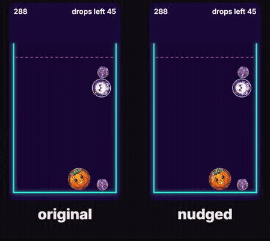

# 🩺 Level Doctor

**An AI agent that writes its own bot players, playtests your web game thousands of times inside a CreateOS sandbox, finds out *why* players lose, and re-tunes your levels with error bars on every number.**



*Same level, same seed, same bot. The only difference: the 4th drop moved by 0.0001 units. One run wins, the other runs out of drops. That's the Chaos Ratio's whole idea.*

Built overnight on Oct 18, 2026, starting from an empty directory. Demo subject: [Mash Pit](https://w.run/boopathiraja/mash-pit), my own 20-level physics merge game, live in a game jam with real players. Tuning its levels by hand took three rounds of guessing. Level Doctor replaces that with measurement.

## The problem

Small game teams tune difficulty by feel. Existing playtesting tools either play in real time (a few runs, no statistics), need an engine plugin, or need ML training. Nobody gives an indie web game **statistically sound difficulty numbers, a diagnosis, and a verified fix** in minutes.

## How it works

```
LLM (Nebius Token Factory / OpenRouter)
  │ 1. reads the game's rules + observation API
  │ 2. WRITES three bot players as JavaScript: casual (random) → regular (greedy) → expert (lookahead)
  ▼
CreateOS sandbox (devbox:1, network locked down: the LLM's code can't reach anything)
  │ 3. runs the REAL game code headless with a virtual clock: ~0.16 s per level, byte-identical replays
  │ 4. thousands of seeded playtests → JSONL
  ▼
Agent loop
  │ 5. skill check: casual < regular < expert on 7 test levels covering every goal type;
  │    crashes and broken bots go back to the LLM, which rewrites its code until they pass
  ▼
Statistics (deterministic, no LLM)
  │ 6. pass rate per level × bot with Wilson 95% intervals
  │ 7. Chaos Ratio, twist exposure, survival-curve tuning (below)
  ▼
Patch → verify with fresh seeds → report page served from the sandbox's live URL → fixed build (a copy)
```

## What's new here

- **Chaos Ratio.** Replay a run with one drop nudged by 0.0001 units (far below a pixel). C = flip rate ÷ 2p(1−p). **C ≈ 1: losses are dice rolls** a designer can only soften. **C ≈ 0: losses are reproducible traps** a designer can find and fix. Pass rate alone can't tell these apart. In the final Mash Pit run, *Tight Squeeze* (regular bot 63%, C = 0.00: a trap) and *The Royal Mash* (63%, C = 0.68: mostly luck) have the same pass rate and opposite fixes. C describes a level *and* a play style. Measured on the same seeds, *Tight Squeeze* is a trap for the regular bot (C = 0.00) and nearly pure luck for the expert (C = 0.88): the regular bot loses the same way every time, the expert loses to dice rolls. Most other levels agree across styles (e.g. *Bouncy Castle* 1.20 vs 1.19), and the report shows both. On ORBITAL (no physics) the same nudge changes 11% of runs but almost never flips one (C = 0.09): its losses are patterns a player can learn.
- **Twist exposure.** Each run is paired with a copy where one twist is switched off (same seeds); identical pairs mean the twist never mattered. A bot playing at typical bot speed clears *Bass Drop!* before the first bass drop arrives: it reports the level is fine without ever hearing its twist (5% of runs exposed vs 100% at human tempo). Level Doctor's bots play at a human 1.2 s per drop.
- **One-batch drop-limit tuning.** Play once with unlimited drops, read the pass rate for *every* possible limit straight off the survival curve, pick the limit that hits the target, then verify it with fresh seeds.
- **Error bars everywhere.** Every pass rate carries a 95% interval; patches count as verified only when the interval reaches the target band.
- **Churn funnel.** A mixed population (40% casual × 3 tries, 40% regular × 5, 20% expert × 8) shows where players would quit, before vs after.

## How the agent fixed its own bots (the real log)

Every round: the LLM writes the module, the agent runs it in the sandbox on 7 test levels × 3 bots × 16 seeds, then sends back what a tester would report (pass rates, why runs ended, goal left over, how varied the drops were).

| Round | Casual · Regular · Expert | What the agent told the LLM |
|---|---|---|
| 1 | crashed | `Cannot read properties of undefined (reading 'x')` in two bots |
| 2 | 78% · 68% · 68% | both skilled bots broken on *Frozen Friends* (ice goal): worse than random play |
| 3 | 78% · 74% · 76% | regular bot still broken on *Frozen Friends* |
| 4 | 78% · 84% · 80% | expert below regular: improve its scoring |
| 5 | 78% · 85% · 86% | ✓ skill ranks correctly, no broken levels |

An earlier attempt taught the agent something too: the LLM's expert scored drop positions at the height where a monster *spawns* instead of where it *lands*, so it never saw a merge. The fix wasn't to hand-write the bot, it was to give the observation API a `landY(x)` helper (what the in-game aim guide shows a player) and better diagnostics.

## Results on Mash Pit (final run, Oct 18)

- **6,560 playtests inside the CreateOS sandbox** (709 s on one vCPU). The same run on local workers matched it **20/20 levels, number for number**: same seeds, same results, Linux sandbox vs Windows laptop.
- **Bots:** Qwen3-235B (Nebius Token Factory) wrote them; the agent ran each version in the sandbox and sent back crashes, skill inversions and per-level diagnostics. Five rounds later: casual 78% < regular 85% < expert 86% across 7 test levels covering every goal type, with no level where a skilled bot loses to random play.
- **Chaos:** on 8 levels losses are dice rolls (C ≥ 0.6, e.g. *Bouncy Castle* 1.20, *Frozen Friends* 1.11); on *Tight Squeeze* (C = 0.00) they are a reproducible trap.
- **Twist exposure:** on 5 levels fast bots miss the DJ twist entirely (*Bass Drop!*: 5% of runs exposed at bot speed vs 100% at human speed). On 5 levels a twist changed few runs at all (e.g. the fog on *Lights Out* changed 0%: the regular bot never looks at the next monster, so hiding it can't matter to that play style).
- **Fix:** 6 levels were far too easy for the target curve; one survival batch proposed new drop limits, and fresh-seed verification confirmed **5 of 6** within error bars (`out/patch.diff`, applied only to a copy). *Slime Time* failed verification and is reported as such.

## Not tied to one game: ORBITAL

The same agent also runs on **ORBITAL**, an endless arcade game (circle a star, tap to reverse, dodge debris), a different genre with no levels at all. `games/orbital/` is the whole adapter: the game's difficulty constants become tunable at load time, bots see the game 0.2 s late (human reaction time), and the "level pass rate" becomes "reaches 20 seconds". The LLM writes three new bots, the agent checks they rank by skill *and* actually play (a "skilled" bot that never taps gets sent back), then measures survival curves and the Chaos Ratio, and tunes how fast debris spawns accelerate so a regular player reaches 20 s half the time, verified with fresh seeds.

```bash
node games/orbital/run.mjs   # bots → survival curves → chaos → tune SPAWN_RAMP → verify → out/orbital-results.json
```

## How accurate is it?

Measured, not assumed (`scripts/accuracy-check.mjs`, results in `out/accuracy.json`):

| Claim | Evidence | Verdict |
|---|---|---|
| Runs reproduce exactly | Same seed → byte-identical run; the full 6,560-run diagnosis in the CreateOS sandbox (Linux) matched a local run (Windows) on 20/20 levels | **Exact** |
| It runs the real game | The unmodified game source is bundled and stepped headless; the patched copy boots in a real browser with the new limits | **Exact** (no rendering/audio; the DJ follows the game clock instead of the music clock) |
| Pass rates have honest error bars | Re-measured every level with 40 fresh seeds: typical change 5 points, intervals ±7 points on average (±15 at worst). 17/20 fresh values fell inside the original 95% interval; with two noisy measurements, honest intervals should catch about 83% | **Calibrated**, but n=40 per level is coarse |
| One-batch tuning predicts the new pass rate | Predicted vs verified: off by 10 points on average, and mostly too low (it ignores the 2.5 s grace after the last drop, when merges can still finish the goal) | **Rough**: that's why every patch is re-verified; 5/6 verified within error bars, 3/6 within 5 points of target |
| Chaos Ratio separates luck from traps | Consistent across play styles on most levels (Bouncy Castle 1.20 vs 1.19), but Tight Squeeze flips (0.00 regular vs 0.88 expert); 30 pairs per level → roughly ±0.3 | **Indicative**, per play style |
| Twist exposure | "Bass Drop!": 5% of runs exposed at bot speed vs 100% at human speed, the same in every bot version tested | **Robust** |
| Predicts difficulty for real humans | Not validated: the bots clear many levels 100% of the time, so "too easy" means too easy *for these bots*; the 95% → 60% target is a designer choice | **Unknown**: needs per-level analytics from real players to calibrate |

## How CreateOS Sandbox is used

**CreateOS Sandbox** (`@nodeops-createos/sandbox`) runs every batch: one reused `devbox:1` sandbox, **egress locked down** (the bots are LLM-written code; `scripts/sandbox-check.mjs` proves an outbound request fails), auto-pause between batches with resume on demand, and **ingress** to serve the report from the sandbox's public URL.

## Run it

```bash
npm install
node src/bundle.mjs                 # bundle the game headless (GAME_SRC=path/to/game/src/main.js)
node scripts/check-determinism.mjs  # gate: same seed → identical run
node scripts/write-bots.mjs         # the agent writes + fixes its bots (needs NEBIUS_API_KEY or OPENROUTER_API_KEY, else local Ollama)
node scripts/run-doctor.mjs         # full diagnosis → out/results.json
node report/build.mjs               # report → report/dist/index.html
node scripts/ship-fixed.mjs         # verified patch applied to a COPY of the game, built
```

Backend: the CreateOS sandbox when `CREATEOS_SANDBOX_API_KEY` is set, otherwise local worker processes running the same `src/batch.mjs` (every result row records where it ran).

## Tech

Node 24 · esbuild · matter-js (the game's own physics, bundled unmodified) · CreateOS Sandbox SDK · Nebius Token Factory (Qwen3-235B) · Playwright + ffmpeg + edge-tts for the demo video.

## Honest limits

- The target curve is a designer choice (95% → 60% for a regular player); calibrate it against real analytics before applying a patch to a live game.
- Bots are only as good as the code the LLM writes; the skill check catches broken bots, not subtly unhuman ones.
- Mash Pit's source is not in this repo: it's the input, a separate live game. All Level Doctor code was written in that one night.
